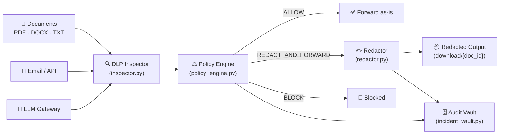

# ZeroLeak AI — Automated Sensitive Data Redaction & DLP Platform


---

## Problem

Sensitive information — Aadhaar numbers, PAN cards, credit card details, API secrets, passwords — flows freely across emails, documents, and digital platforms. Identifying and protecting confidential data across heterogeneous file formats (PDF, DOCX, CSV, plain text) before it reaches the wrong destination is operationally difficult, error-prone, and legally consequential under India's **Digital Personal Data Protection (DPDP) Act, 2023**.

Manual redaction is slow and inconsistent. Rule-based filters miss context. Organisations need an automated, auditable DLP pipeline that can inspect, decide, redact, and log — without ever exposing raw PII in transit or in logs.

---

## Solution Overview

ZeroLeak AI is a full-stack DLP platform that:

1. **Inspects** uploaded documents for 15+ PII and secret types using regex, checksum validators, and contextual heuristics.
2. **Evaluates** each document against a YAML-driven policy engine that emits `ALLOW`, `REDACT_AND_FORWARD`, or `BLOCK` based on destination and detected entity types.
3. **Redacts** documents in-place using four modes (full, partial, irreversible, tokenize) with post-redaction verification.
4. **Logs** every incident to a zero-raw-PII audit vault (SHA-256 hashes only, never raw values).
5. **Surfaces** everything through a React/Vite UI with a drag-and-drop Scan & Redact interface and an Audit Log tab.

---

## Architecture



---

## Supported Formats

| Format | Channel | Redaction mechanism |
|--------|---------|---------------------|
| PDF | `document_channel.py` | PyMuPDF `add_redact_annot` + `apply_redactions` (physical pixel removal) |
| DOCX | `document_channel.py` | python-docx — paragraph runs and table cells |
| TXT / JSON / CSV / MD / LOG | `document_channel.py` | Plain-text string replacement |

> [!NOTE]
> Image-only (scanned) PDFs are not supported — OCR is not yet integrated. Text-based PDFs only.

---

## Detection Layers

| # | Layer | What it catches |
|---|-------|-----------------|
| 1 | **Regex PII patterns** | AADHAAR, PAN, PHONE, EMAIL, GSTIN, PASSPORT, VOTER\_ID, NAME, ADDRESS, FINANCIAL, DATE\_OF\_BIRTH, BANK\_ACCOUNT |
| 2 | **Verhoeff checksum** | 12-digit Aadhaar — dihedral group D5 validation; first digit must be 2–9 |
| 3 | **Luhn mod-10 + issuer prefix** | Credit/debit cards 13–19 digits; Visa, Mastercard, Amex, RuPay, Discover |
| 4 | **PAN 4th-character validator** | Statutory person-type codes: P, C, H, F, A, B, G, J, L, T |
| 5 | **Bank account contextual cue** | 9–18 digits — only flagged when a nearby keyword (account, a/c, bank) is present |
| 6 | **Secrets / credentials regex** | JWT (`eyJ…`), OpenAI keys (`sk-…`), AWS access keys (`AKIA…`), GitHub tokens (`gho_`, `ghp_`, `ghs_`, `ghr_`), Bearer tokens, `password=`, `api_key=`, `secret_key=` assignments |
| 7 | **Span deduplication** | Statutory and secret entity types supersede overlapping generic NAME / ADDRESS matches |

---

## Redaction Modes

| Mode | Output example | Notes |
|------|---------------|-------|
| `full` | `[REDACTED: AADHAAR]` | Replaces the entity with a typed label |
| `partial` | `XXXX-XXXX-1234`, `j***@corp.com` | Masks all but the last 4 chars / domain |
| `irreversible` | `████████` | Block characters matching the raw value's length |
| `tokenize` | `[AADHAAR_1]`, `[EMAIL_2]` | Format-preserving sequential token; same value → same token within a document |

> [!IMPORTANT]
> After redaction, the pipeline automatically re-scans the output. `verified = true` is set only when `findings_remaining == 0`.

---

## Policy Examples (`policies/default.yaml`)

```yaml
name: default_dlp_policy
version: 1.0.0

destination_rules:
  external:
    block_types:
      - AADHAAR
      - CREDIT_CARD
      - SECRET_KEY
      - JWT_TOKEN
      - PASSWORD
    redact_types:
      - PAN
      - PHONE
      - EMAIL
      - PASSPORT
      - VOTER_ID
      - GSTIN
      - BANK_ACCOUNT
      - NAME
      - ADDRESS

  internal:
    block_types:
      - SECRET_KEY
      - PASSWORD
    redact_types:
      - AADHAAR
      - CREDIT_CARD

sensitivity_classification:
  confidential_types:
    - AADHAAR
    - CREDIT_CARD
    - SECRET_KEY
    - JWT_TOKEN
    - PASSWORD
  internal_types:
    - PAN
    - PHONE
    - EMAIL
    - PASSPORT
    - VOTER_ID
    - GSTIN
    - BANK_ACCOUNT
    - NAME
    - ADDRESS
  risk_thresholds:
    confidential: 50.0
    internal: 20.0
```

**Policy actions emitted:**

| Action | Meaning |
|--------|---------|
| `ALLOW` | No blocked or redact-type entities found — forward as-is |
| `REDACT_AND_FORWARD` | Redactable entities present — apply redaction then forward |
| `BLOCK` | At least one block-type entity found — halt transmission |

Risk score is a weighted sum of entity type weights (e.g. `SECRET_KEY` = 40, `AADHAAR` = 35, `CREDIT_CARD` = 30, `PAN` = 25, …) plus a linkability bonus when multiple identity fields co-occur.

---

## API Endpoints — `/api/v1/dlp`

### `POST /api/v1/dlp/scan`

Inspect a document for sensitive data.

| Parameter | Type | Description |
|-----------|------|-------------|
| `file` | multipart file | PDF, DOCX, TXT, CSV, JSON, MD, LOG |
| `destination` | form string | `external` or `internal` |
| `department` | form string | Free-form department label |

**Response:**
```json
{
  "doc_id": "uuid",
  "filename": "contract.pdf",
  "format": "pdf",
  "sensitivity": "CONFIDENTIAL",
  "risk_score": 85.0,
  "findings": [
    {
      "id": "uuid",
      "type": "AADHAAR",
      "confidence": 0.99,
      "page": 1,
      "start": 142,
      "end": 154,
      "masked_preview": "XXXX-XXXX-1234"
    }
  ],
  "decision": {
    "action": "BLOCK",
    "reasons": ["AADHAAR is blocked for external destination"]
  }
}
```

---

### `POST /api/v1/dlp/redact`

Redact a document and store the output for download.

| Parameter | Type | Description |
|-----------|------|-------------|
| `file` | multipart file | Same formats as scan |
| `mode` | form string | `full` \| `partial` \| `irreversible` \| `tokenize` |

**Response:**
```json
{
  "doc_id": "uuid",
  "download_url": "/api/v1/dlp/download/uuid",
  "findings_removed": 7,
  "findings_remaining": 0,
  "verified": true
}
```

---

### `GET /api/v1/dlp/download/{doc_id}`

Download the redacted file. Returns the file bytes with `Content-Disposition: attachment; filename="redacted_<original>"`.

---

### `GET /api/v1/dlp/audit`

Retrieve the zero-raw-PII audit log.

```json
[
  {
    "incident_id": "uuid",
    "timestamp": "2026-11-17T10:00:00Z",
    "filename": "contract.pdf",
    "destination": "external",
    "department": "Legal",
    "sensitivity": "CONFIDENTIAL",
    "risk_score": 85.0,
    "action": "BLOCK",
    "entity_type": "AADHAAR",
    "entity_count": 2,
    "value_hash": "sha256:abc123..."
  }
]
```

> [!CAUTION]
> `value_hash` is SHA-256 of the first 16 characters of the raw value — never the raw value itself.

---

## Security Design

| Property | Implementation |
|----------|---------------|
| **Zero raw PII in API responses** | `DLPFinding` contains only `entity_type`, `confidence`, `page`, `start`, `end`, `masked_preview` — never the raw string |
| **Zero raw PII in logs** | Audit vault stores `SHA-256(raw_value[:16])` — hash only |
| **Thread safety** | `incident_vault.py` uses `threading.Lock()` around all read/write operations |
| **Ephemeral download store** | Redacted files live in an in-memory dict; a server restart clears all download links |
| **Post-redaction verification** | The redacted output is re-scanned; `verified = true` only if `findings_remaining == 0` |
| **No persistent PII storage** | No database rows contain raw PII; all identifiers are doc\_id UUIDs or hashes |

---

## DPDP Modules

The following modules implement compliance primitives under the **Digital Personal Data Protection Act, 2023**:

| Module | Purpose |
|--------|---------|
| `app/dpdp/consent_engine.py` | Consent lifecycle — capture, track, withdraw |
| `app/dpdp/rights_workflow.py` | Data principal rights: access, correction, erasure |
| `app/dpdp/breach_manager.py` | Breach detection and notification workflow |
| `app/dpdp/retention_manager.py` | Automated data retention and purge policies |
| `app/dpdp/grievance_officer.py` | Grievance registration and resolution tracking |
| `app/dpdp/crypto_vault.py` | Key management and cryptographic operations |

---

## Running Tests

```bash
# DLP unit tests (hackathon additions)
pytest tests/test_dlp_inspector.py -v
pytest tests/test_dlp_redactor.py -v
pytest tests/test_dlp_policy_engine.py -v
pytest tests/test_dlp_incident_audit.py -v

# Full test suite
pytest tests/ -v

# Specific coverage areas
pytest tests/test_api.py -v                    # API contract
pytest tests/test_dpdp_compliance.py -v        # DPDP module compliance
pytest tests/test_injection_detection.py -v    # Injection / XSS safety
pytest tests/test_pipeline_integration.py -v   # End-to-end pipeline
pytest tests/test_risk_scoring.py -v           # Risk weight calculations
pytest tests/test_policies.py -v               # Policy engine rules

# Frontend build check
npm run build
```

The `tests/inputs/` directory ships a synthetic test pack (10 files covering all entity types, edge cases, and negative/rejection cases). Answer keys are in `tests/keys/`. All synthetic Aadhaar numbers pass Verhoeff, cards pass Luhn, and GSTIN values pass their checksum — making them valid test targets without any real PII.

---

## Demo Steps

```bash
# 1. Start the backend
uvicorn app.main:app --reload --port 8001

# 2. Start the frontend (separate terminal)
npm run dev
```

3. Open `http://localhost:3000` in your browser.
4. Click **Scan & Redact** in the navigation bar.
5. Drag-and-drop a PDF, DOCX, or TXT file onto the upload zone.
6. Select **Destination** (`external` / `internal`) and **Department**.
7. Click **Run Scan** — review:
   - Sensitivity badge (PUBLIC / INTERNAL / CONFIDENTIAL)
   - Risk score gauge
   - Policy decision banner (green ALLOW / blue REDACT\_AND\_FORWARD / red BLOCK) with reasons
   - Findings table grouped by entity type with confidence and masked preview
8. Choose a **Redaction Mode** and click **Apply Redaction**.
9. Review the verification card — green ✅ if `verified = true` and `findings_remaining = 0`.
10. Click **Download Redacted File** to save the output prefixed with `redacted_`.
11. Switch to the **Audit Log** tab to see zero-raw-PII incident records.

> [!TIP]
> Set `VITE_USE_MOCK=true` in a `.env.local` file to run the frontend against mock data without a live backend.

---

## Limitations & Roadmap

### Current Limitations

- **Ephemeral downloads** — the redacted-file download store is in-memory; a backend restart clears all pending download links.
- **No OCR** — image-only (scanned) PDFs are not inspected; text must be embedded in the PDF.
- **No Hindi / Devanagari in PDF** — the PDF channel processes embedded text only; non-Latin scripts depend on the PDF's text layer.
- **DOCX header/footer/comments not scanned** — only paragraph runs and table cells are inspected.
- **No email channel** — the UI exposes an email destination option, but no IMAP/SMTP scanning backend exists yet.
- **In-memory audit store** — the incident vault is a thread-safe in-memory list backed by a single JSON file; not suitable for multi-process or distributed deployments.

### Roadmap

- [ ] Email channel — IMAP/SMTP integration for real-time scanning of outbound mail
- [ ] OCR integration — Tesseract / Google Vision for scanned PDFs and images
- [ ] DOCX header, footer, comment, and tracked-changes scanning
- [ ] Database-backed audit persistence (PostgreSQL / Cloud Spanner)
- [ ] Role-based access control for redaction operations
- [ ] Real-time streaming scan for large files (chunked upload + SSE progress)
- [ ] Multi-language PII detection (Hindi, Tamil, Bengali)
- [ ] Differential privacy noise injection for analytics outputs

---

## Hackathon Additions

The following components were built during the hackathon sprint on top of the base **PrivaGuard AI** platform:

| Addition | Location | Description |
|----------|----------|-------------|
| DLP inspection engine | `app/dlp/` | Inspector, redactor, policy engine, incident vault, document channel |
| DLP REST routes | `app/api/dlp_routes.py` | Four endpoints under `/api/v1/dlp` |
| Default DLP policy | `policies/default.yaml` | YAML-driven destination rules and sensitivity classification |
| Scan & Redact UI | `src/pages/ScanRedactPage.tsx` + `src/lib/scanRedactApi.ts` | Full-featured React frontend with mock fallback |

---

## Attribution

> **ZEROLEAK AI — test pack**
> All data in `tests/inputs/` is synthetic. Aadhaar numbers pass Verhoeff, cards pass Luhn, GSTIN passes its checksum.
> Each file in `inputs/` has an answer key in `keys/` (expected sensitive values with a location, plus `must_not_flag` traps).
